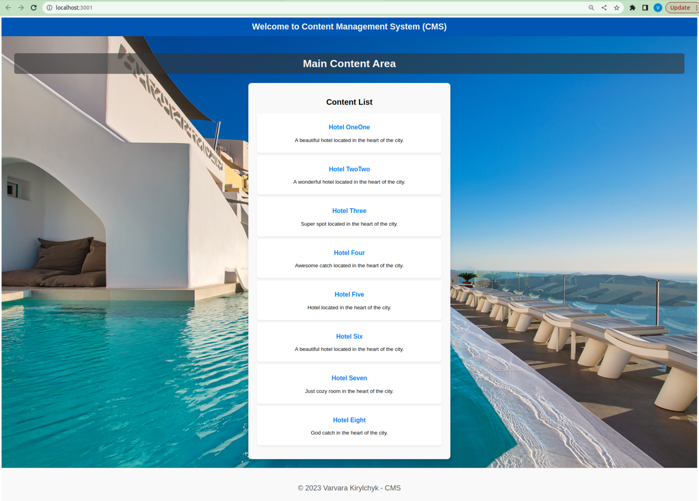
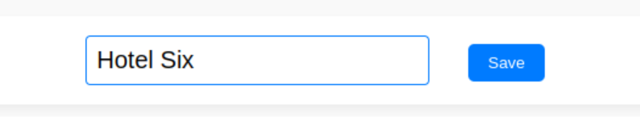
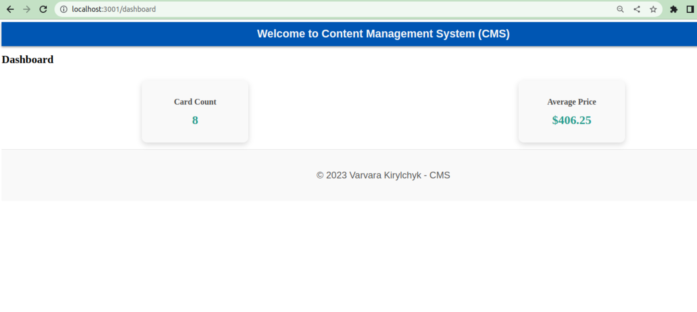

# :bulb: Project

## Content Management System (CMS)

## :rocket: Stack:
- **Frontend**: React.js
- **Backend**: Node.js
- **Database**: MongoDB (same cluster used for project-book-hotel-app)

- npm start -> separately launches frontend and backend

### :sparkles: Description

The Content Management System (CMS) crafted for the Project Book Hotel App is a pivotal tool designed to simplify content management, offering a seamless, user-friendly interface for administrators and content managers. This CMS enables comprehensive CRUD (Create, Read, Update, and Delete) functionalities, allowing for efficient management of the accommodation listings, or 'cards', which include essential details like names, descriptions, pricing, and images. Its intuitive design facilitates straightforward additions, modifications, and deletions of listings, ensuring that the platform remains current and user-centric.

Further enhancing its utility, the CMS incorporates advanced features such as bulk operations, detailed search and filtering options, and version control. These features not only streamline the management process but also ensure the accuracy and reliability of the content on the Project Book Hotel App. As a result, the CMS plays a critical role in maintaining the dynamic and up-to-date nature of the app, directly contributing to an enriched user experience by providing the latest accommodation options and information.

The system is designed to manage content of the **project-book-hotel-app**.
(Link: https://github.com/Kirylchyk/project-book-hotel-app)

**The application offers a user-friendly interface** 
that allows users to manage the content of the booking app. 

Users are able to CRUD:
- create
- read
- update
- delete any card(s).

**Screens**:
- :white_check_mark: Login Page 
- :white_check_mark: Main Page
- :white_check_mark: Dashboard 

**Functions**:
- :white_check_mark: Pagination
- :white_check_mark: Hover-over effects

## **Screen: Dashboard**
The screen displays two widgets. Widget "Card Count" calculates 
in backend the total ids of cards stored in db and gets the number via get-request.

Widget "Average Price" counts average price listed in bd.

**Notes**:
- :construction: Version Control: The system allows users to see previous versions of content (draft)
- :construction: Users with different permissions (draft)
